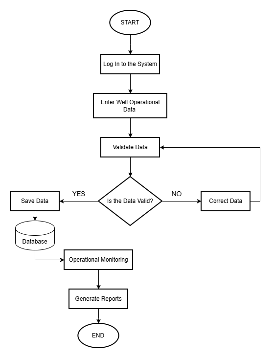

# System Workflow

1. The Operational Administrator enters well operational data through the system.
2. The system validates the entered data, including data completeness and format.
3. If the data is invalid or incomplete, the system displays an error message and asks the user to make corrections.
4. If the data is valid, the system stores it in a centralized database.
5. The stored data can be accessed by the Operational Administrator and Department Head for monitoring purposes.
6. The system processes the available data to generate operational reports.
7. The generated reports are used as a basis for operational decision-making.

## System Flowchart

  
   
  <em>Well Operational Control System Flowchart</em>

This flowchart illustrates the workflow of the Well Operational Control System, from user data entry to the generation of operational reports.

The entered data undergoes validation to ensure completeness and consistency. If the data is invalid, the user must make corrections before it is stored in the database.

The stored data is then used for operational monitoring and report generation as a basis for evaluation and decision-making.
